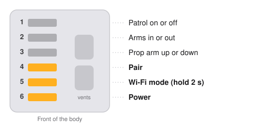
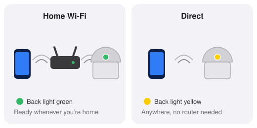
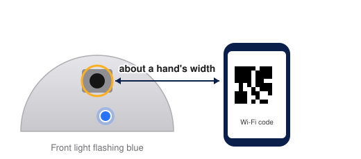
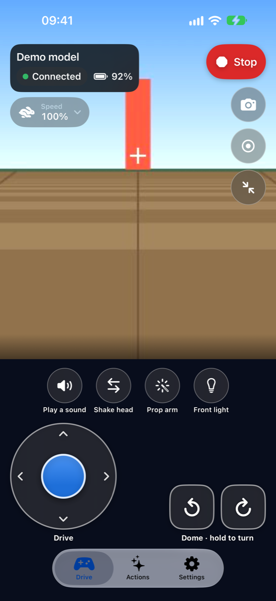
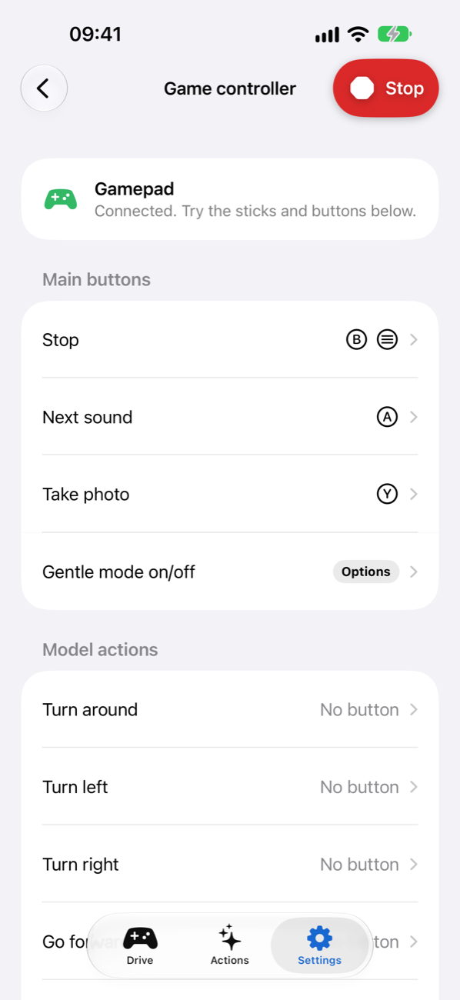

# Getting started

Allow about five minutes. Have your model in front of you.

You can try the app without the model at any time: tap **Try the demo** on the first
screen.

## 1. Switch your model on

1. Flip the main power switch. It is underneath, on the right-hand side as the model
   faces you.
2. If both round lights on the dome are still off, press **button 6** briefly. It is the
   bottom one in the column of six buttons on the front of the body.
3. Wait until the front light is purple  and the model makes a sound.

The six buttons have no labels. Button 1 is at the top and button 6 at the bottom.

More in [lights and buttons](lights-and-buttons).

## 2. Decide how to connect

The model has two Wi-Fi modes. The **back light** on the dome shows which it is in.

| | Back light | Mode | Use it when |
|---|---|---|---|
|  | Green | Home Wi-Fi | You want the model ready whenever your phone is on your Wi-Fi. The usual choice. |
|  | Yellow | Direct | You are away from home, or you just want to try it. The model makes its own Wi-Fi network for your phone. |

Hold **button 5** (second from the bottom) for two seconds to switch between them.

## 3a. Connect directly (quickest)

1. Make sure the back light is yellow .
2. In Dome Pilot tap **Find my model**, then **Connect directly instead**.
3. Allow the app to join the model's network when your device asks. The network's name
   starts with "R2D2-Router". If your device doesn't offer to join it, the app shows how
   to join in Settings.

## 3b. Put the model on your home Wi-Fi

Your network must be **2.4 GHz**. The model cannot use 5 GHz. If your router gives both
bands one shared name, the model may join and then drop off; a separate 2.4 GHz network
is more reliable.

1. Make sure the back light is green .
2. In Dome Pilot choose **My model isn't on my Wi-Fi yet** (first set-up), or **Put it on
   my home Wi-Fi** from the model's menu in your list of models.
3. Type your Wi-Fi name and password. Capital letters matter.
4. Press **button 4** (third from the bottom). The front light flashes blue slowly
    for about 30 seconds.
5. Tap the button in the app to show the code, and hold it about a hand's width from the
   camera at the top of the dome. The model buzzes when it has read it.

   

6. The app finds the model on your Wi-Fi and connects.

If the front light flashes red slowly , the model read the code but could not join.
Check the password and that the network is 2.4 GHz, then press button 4 and try again.

## 4. Pair your device

On home Wi-Fi the model only obeys devices it has been paired with. The first time, the
app asks you to press **button 4**; when the front light flashes blue
, tap the button in the app. After that it reconnects by itself.

## 5. Drive

- The joystick drives; the two round arrows turn the dome.
-  **Stop** is always at the top right. It stops everything at once.
- Start in a clear space. The model's obstacle sensors are off while you drive it
  yourself.
- Gentle mode (tap the speed chip) limits the speed and asks before any routine that
  makes the model travel.

##  Game controllers

Pair any controller with your iPhone or iPad in the usual way. The left stick drives,
the right stick turns the dome, and one button is always Stop. You can change what each
button does in Settings, Game controller.

## Next

- [Using Dome Pilot](using-dome-pilot): actions, sounds, sequences, photos and settings
- [Siri and Shortcuts](siri-and-shortcuts)
