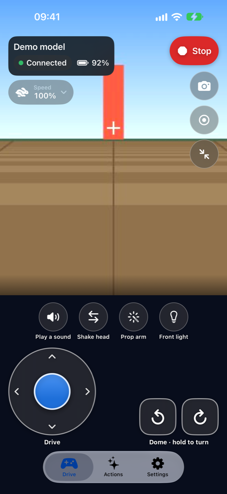
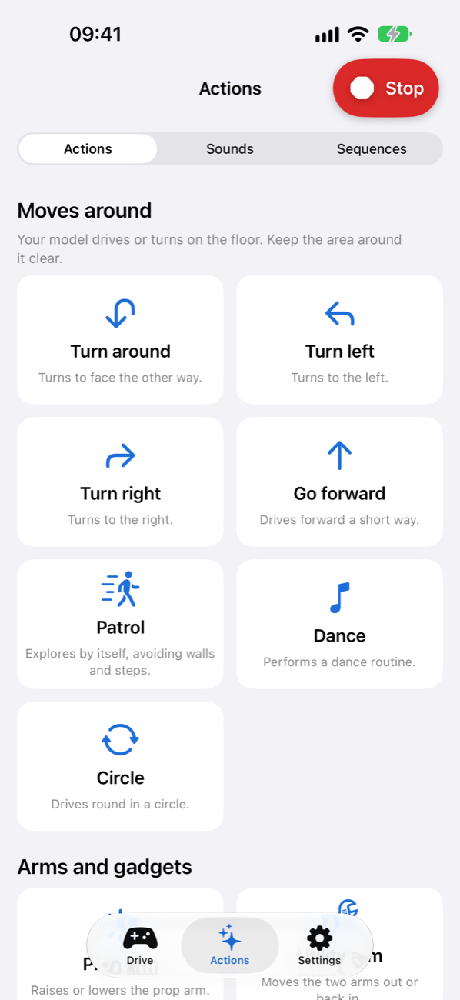
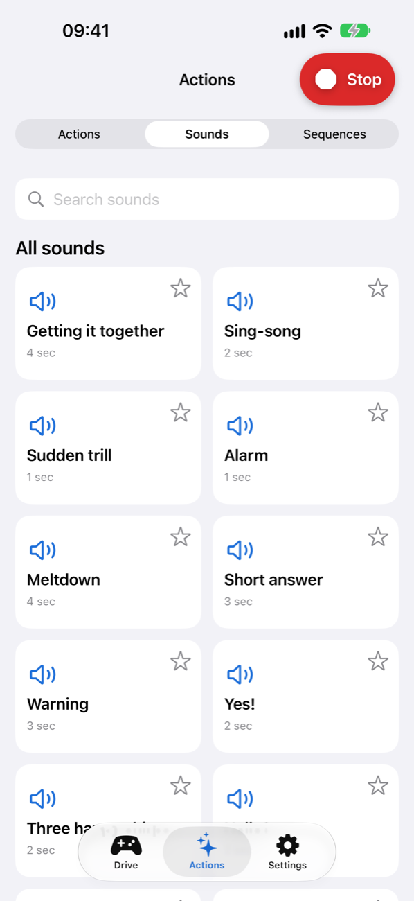
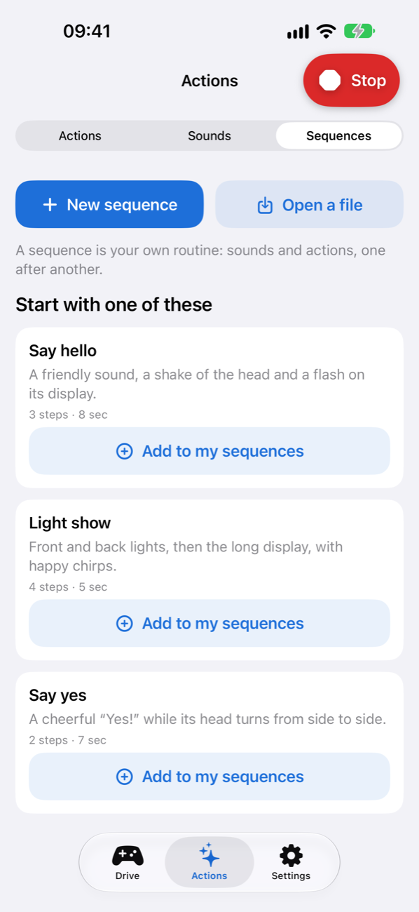
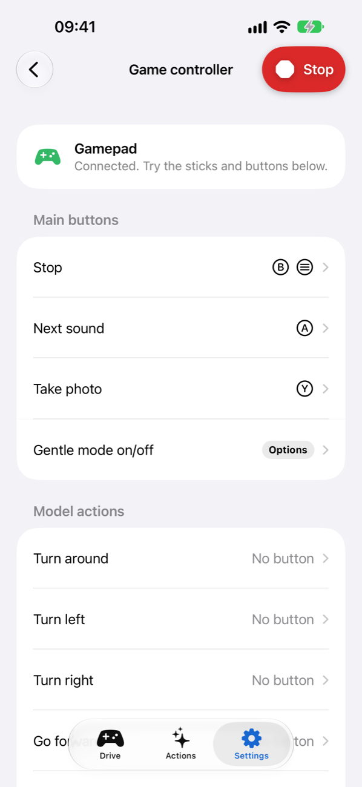
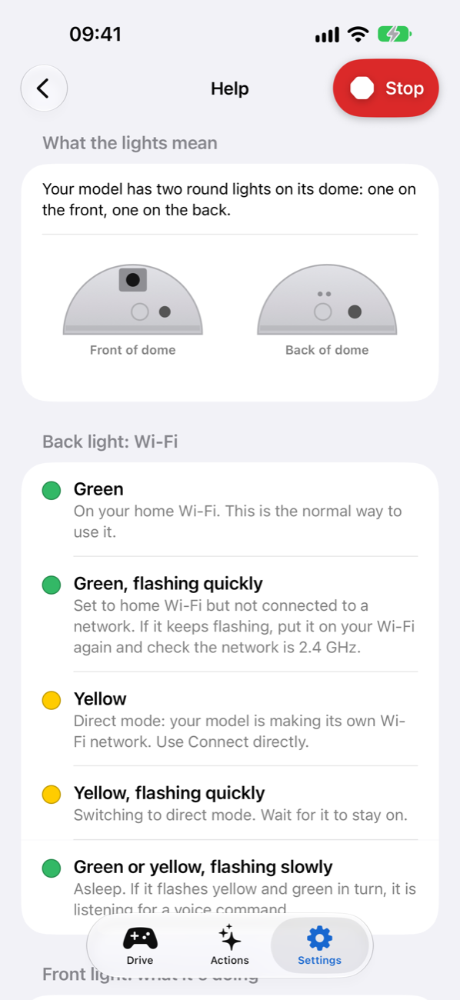

# Dome Pilot

**A remote control app for iPhone and iPad for the De Agostini / Fanhome Build Your Own
R2-D2 1:2 scale part-work model.**

If you built the model, published by De Agostini from 2017 and later sold by Fanhome,
you will know that its companion app is no longer available. Without it the model's
camera, driving controls, sounds and routines cannot be used. Dome Pilot is a new,
independent app that controls the model over Wi-Fi.

**[Get Dome Pilot on the App Store](https://apps.apple.com/app/dome-pilot/id6838233662)**:
free, for iPhone and iPad.

## Screenshots

  
  
  

  
  
  

1. Drive screen: live camera picture, joystick, dome buttons and Stop
2. Actions: the model's built-in moves and lights
3. Sounds: every built-in sound, with favourites
4. Sequences: your own chains of actions, sounds and pauses
5. Game controller: choose what each button does
6. Help: what the model's lights and buttons mean

The pictures show the app's built-in demo, which works without the model.

## What it does

- Drive with an on-screen joystick, or with any game controller paired with your device
- See through the model's camera, take photos and record video
- Turn the dome, play every built-in sound and run every built-in routine
- Build, save and share your own sequences of actions and sounds
- Works on your home Wi-Fi (2.4 GHz) or connected straight to the model
- Step-by-step set-up with pictures of which button to press and which light to watch
- [Siri and Shortcuts](siri-and-shortcuts)
- A built-in demo, so you can try it without the model
- No account, no ads, no tracking

## What you need

- The completed model, with its electronics fitted and working
- An iPhone or iPad running iOS 17 or later
- For home Wi-Fi use, a 2.4 GHz network. The model cannot join 5 GHz networks.

## Help

-  [Getting started](getting-started)
-  [Using Dome Pilot](using-dome-pilot)
-  [Siri and Shortcuts](siri-and-shortcuts)
-  [Lights and buttons](lights-and-buttons)
-  [Troubleshooting](troubleshooting)
-  [Support and feedback](support)
- [Privacy policy](privacy)

## Independence and trademarks

Dome Pilot is an independent app. It is not affiliated with, endorsed by or sponsored by
De Agostini, Fanhome, Lucasfilm Ltd or Disney. R2-D2 and Star Wars are trademarks of
Lucasfilm Ltd. De Agostini and Fanhome are trademarks of their respective owners. These
names are used only to identify the model the app works with.
