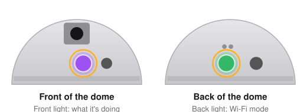
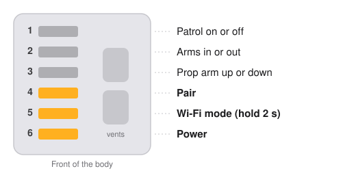

# Lights and buttons

## The two lights

The model has two round lights on its dome: one on the front, below the camera, and one
on the back.

The icons below flash at about the same speed as the real lights.

### Back light: Wi-Fi

| | Light | Meaning |
|---|---|---|
|  | Green | On your home Wi-Fi. The usual way to use it. |
|  | Green, flashing quickly | Set to home Wi-Fi but not connected to a network. If it keeps flashing, put it on your Wi-Fi again and check the network is 2.4 GHz. |
|  | Yellow | Direct mode: the model is making its own Wi-Fi network. |
|  | Yellow, flashing quickly | Switching to direct mode. Wait for it to stay on. |
|   | Green or yellow, flashing slowly | Resting after a few minutes with nothing to do. |
|  | Yellow and green in turn | Listening for a voice command. |

While the charger is plugged in, the back light can show green even though the model is
not on your Wi-Fi. See [troubleshooting](troubleshooting#it-disappears-while-its-charging).

### Front light: what the model is doing

| | Light | Meaning |
|---|---|---|
|  | Purple | Switched on and ready. |
|  | Blue, flashing slowly for about 30 seconds | Pair mode, after you press button 4. Ready to pair with a new device or to read a Wi-Fi code. |
|  | Quick flashes, with a buzz | It has read the Wi-Fi code and is joining your Wi-Fi. |
|  | Red, flashing slowly | It could not join your Wi-Fi. |
|  | Red | Battery below 20%. Also red for a moment while starting up. |
|  | Purple, flashing slowly | Charging. |
|  | Blue, while on the charger | Fully charged. |
|  | Off | Resting; the back light flashes slowly. |

## The six buttons

They are in a column on the front of the body, to the left of the two vents, and have no
labels. Button 1 is at the top. The three you'll use most are highlighted.

| Button | Position | What it does |
|---|---|---|
| 1 | Top | Patrol on or off. The model drives around by itself, so clear the floor first. |
| 2 | Second from the top | Arms in or out. |
| 3 | Third from the top | Prop arm up or down. |
| 4 | Third from the bottom | Pair. Press once: the front light flashes blue for about 30 seconds. |
| 5 | Second from the bottom | Mode. Hold for two seconds to switch between home Wi-Fi and direct mode. |
| 6 | Bottom | Power. Press briefly to switch on or off; hold to force it off. |

The main power switch is separate. It is underneath, on the right-hand side as the model
faces you.
