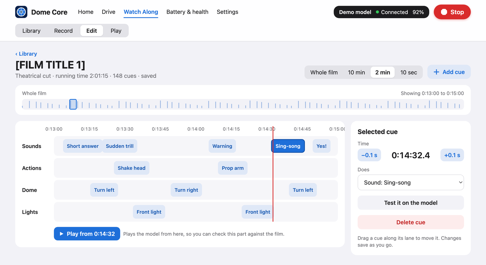

# Roadmap

Dome Pilot is a free, independent app for the De Agostini / Fanhome 1:2 scale model. This
page shows what's done, what's next and what we're exploring. Plans can change, and
nothing here has a date. If something matters to you, say so on
[GitHub](https://github.com/chris-skitch/dome-pilot/issues/new/choose): it really does
shape the order.

## ✅ Available now: Dome Pilot 1.0

- Drive with an on-screen joystick or a game controller
- Live camera, photos and video
- Every built-in sound, action and routine
- Your own sequences, shareable as files
- Home Wi-Fi or a direct connection, with step-by-step set-up
- [Siri and Shortcuts](siri-and-shortcuts)
- A demo mode, so you can try it without the model
- No account, no ads, no tracking

## 🔜 Next: Dome Pilot 1.1

- **Fixes** from your reports
- **Faster finding:** the app spots your model almost instantly, without searching the
  whole network
- **Battery widget:** your model's battery on your Home Screen, and as a Live Activity
  while you drive
- **Siri knows your model's name:** "Artoo's battery is at 92 percent"
- **Open source:** the app's source code published on GitHub, so anyone can see how it
  works, suggest fixes or build on it

## 🛠 Later: Dome Core and Dome Pilot 2.0

**Dome Core** is an optional add-on: a small always-on box (a Raspberry Pi) that looks
after your model. Dome Pilot keeps working fully without it.

- **Watch Along:** your model reacts in time with a film, with a chirp, a dome turn or a
  light at the right moment.
  - Each film has a **cue track**, which you make in Dome Core's web pages by tapping
    along as you watch, then fine-tuning on a timeline.
  - Cue tracks are **free, community-made files** that you share and import. Nothing
    from any film is included, only timings.
  - Play from your iPhone or iPad, or **hand over to Dome Core** and put your phone down.
  - With Home Assistant, Dome Core can follow your player (Apple TV, Plex, Kodi), so
    pausing the film pauses your model.

  

  *Early mockup of the Edit page, where you fine-tune a cue track. Not final.*
- **Drive from any browser,** including Android phones and computers
- **Shared camera:** several devices can watch at once
- **Guest mode:** a simple page for children and visitors, with the sounds you choose and
  slow or no driving. They join by scanning a QR code.
- **Home Assistant:** battery, sounds and actions in your smart home
- **Battery history and health:** how long a charge really lasts, and how the battery
  holds up over months
- **Back online and charged:** a notification when your model has finished charging
- **Several models** under one Dome Core, settings backed up and shared between your
  devices, and a local API for makers

**Dome Pilot 2.0** brings all of this into the app: a new Watch Along tab, handing over to
Dome Core, a model switcher, and guest mode with a QR code.

## 🔬 Exploring: custom firmware for the model

Today the model goes completely offline while it's on its charger, and a model on a shelf
is on its charger most of the time. That rules out anything "always ready". We're
researching **replacement software for the model's own board** that would keep it
reachable while it charges.

**This is research, not a promise.** It may turn out to be impossible, or not safe for
the battery. If it does happen, it will be **optional**, with a way back to the original
software. It would unlock:

- **Ambient mode:** the occasional chirp and dome glance while it sits on the shelf, with
  quiet hours
- **Greeter:** reacting when someone arrives home or the doorbell rings
- **Schedules:** a morning routine, birthdays, Halloween
- **Voice control through your smart home,** for example "Hey Siri, wake the model",
  without opening the app
- **Checking on it** while you're out
- **Live alerts** while it's parked
- **Follow-me and reacting to faces,** with firm safety limits

### 🙏 Can you help? Wanted: a spare controller board

Testing new firmware on a working model risks breaking it. To test safely, we're looking
for a **spare main controller board, the one supplied with issue 99**, that someone would
be willing to donate. It might be left over from a replacement, or from a build that was
never finished. If you have one, please reply on the
[Wanted: spare controller board](https://github.com/chris-skitch/dome-pilot/issues/1) issue. Thank you!

## 💭 Maybe

- **An Android app.** Driving from a browser through Dome Core covers the basics first.

### 🙏 Can you help? Wanted: an Android phone or tablet

An Android version can't be built and tested without an Android device to try it on. If
you have a spare phone or tablet running a reasonably recent version of Android that
you'd be willing to donate, please reply on the
[Wanted: an Android phone or tablet](https://github.com/chris-skitch/dome-pilot/issues/3)
issue. Thank you!
