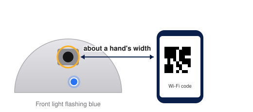

# Troubleshooting

## The app can't find my model

- Is the model switched on? Main switch underneath, then button 6 if both dome lights
  are off. Wait for the front light to go purple
  .
- Look at the **back light**. Green
  
  means home Wi-Fi: your device must be on the same Wi-Fi. Yellow
  
  means direct mode: use **Connect directly**.
- Back light flashing green quickly
  :
  the model is set to home Wi-Fi but has not joined a network. Put it on your Wi-Fi again.
- Is it charging? It can't be reached until about a minute after you unplug it.
- Is it a 2.4 GHz network? The model cannot use 5 GHz.
- Finding can take up to about 30 seconds. If you know the model's address, use **Type
  its address**.
- Did you allow Dome Pilot to find devices on your network? Check Settings, Privacy and
  Security, Local Network.

## It joined my Wi-Fi once and then dropped off

This happens on networks that share one name between 2.4 GHz and 5 GHz. Give the model a
network that is 2.4 GHz only, such as a separate "IoT" or guest network that your phone
can also reach.

## The model didn't read the Wi-Fi code

- The front light must be flashing blue
  
  while you hold up the code. Press button 4 again.
- Hold the screen about a hand's width from the camera at the top of the dome.

  

- Turn the room lights down a little and avoid glare on the screen.

## It read the code but didn't join

The front light flashes red slowly
. Check the Wi-Fi name and password, including
capital letters, and that the network is 2.4 GHz.

## "Press the pair button" keeps coming back

The model only accepts a new device for about 30 seconds after button 4 is pressed.
Press it, wait for the slow blue flashing
, then tap the button in the app straight away.

## The connection drops now and then

- Move the model and your router closer together, or use direct mode to compare.
- The model keeps announcing itself even when its Wi-Fi link is too weak to carry
  commands, so it can look connected to the network when it is not reachable.
- When it happens, share the app's diagnostics in a
  [problem report](https://github.com/chris-skitch/dome-pilot/issues/new/choose).

## It disappears while it's charging

That's normal. While the charger is plugged in, the model leaves the Wi-Fi completely, so
neither Dome Pilot nor Siri can reach it. The back light may stay green; that shows the
mode it's set to, not that it's connected.

| | Front light while charging |
|---|---|
|  | Purple, flashing slowly: charging |
|  | Blue: fully charged |

About a minute after you unplug the charger, it rejoins your Wi-Fi by itself and Dome
Pilot can find it again.

## No camera picture

Only one phone or tablet can use the camera at a time. Close the app on any other device.

## The model won't move

- Tap Stop once and try again: after a stop, let go of the controls and press again.
- Check the battery reading at the top of the Drive screen. A red front light
  
  means it's below 20%.
- A routine may be running. Stop ends it.
