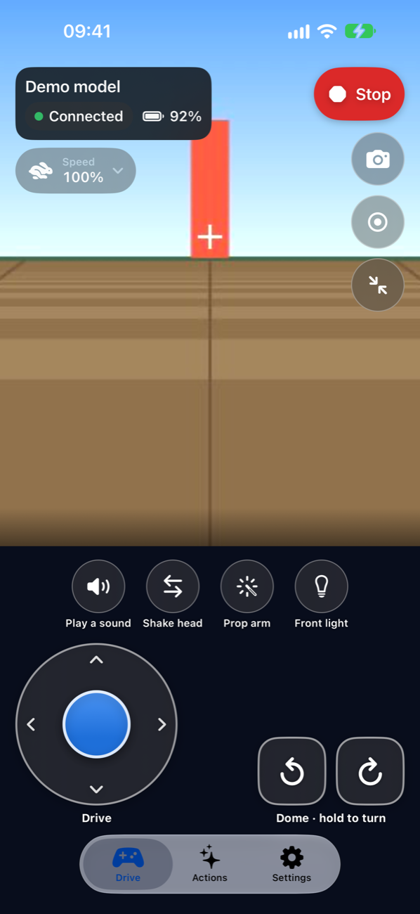
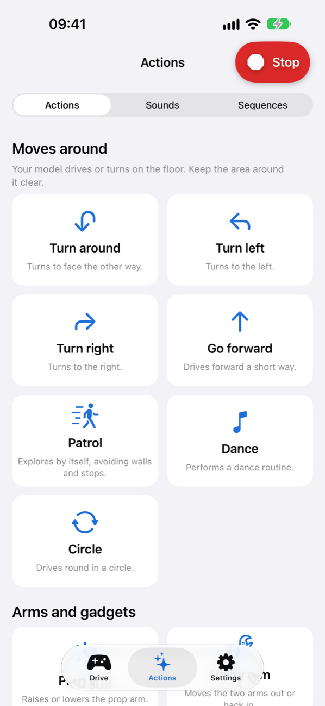
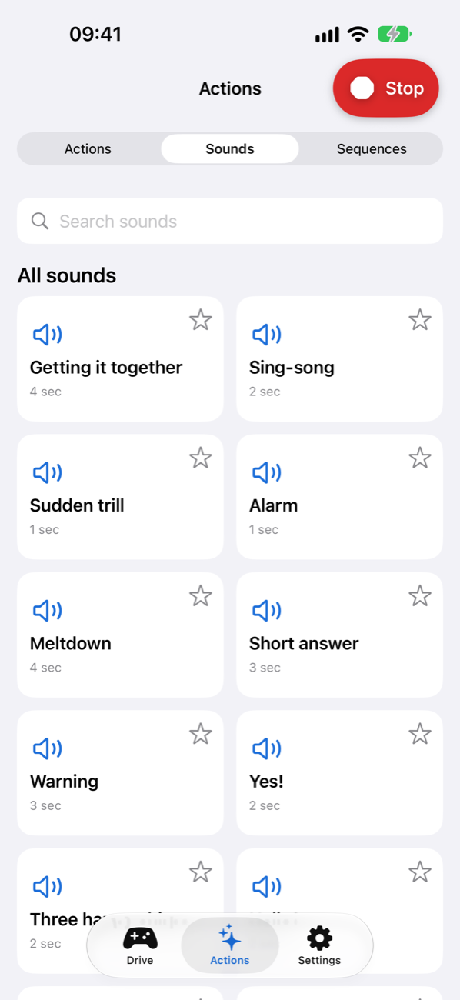
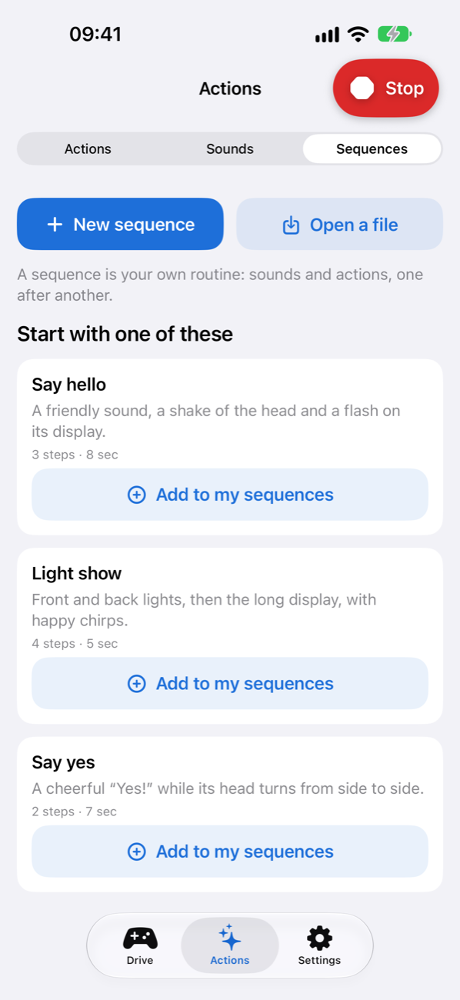
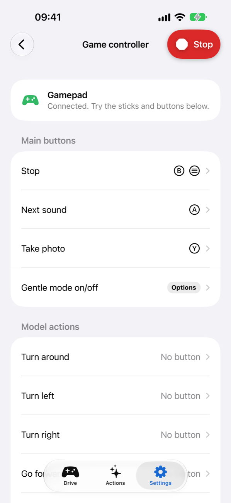
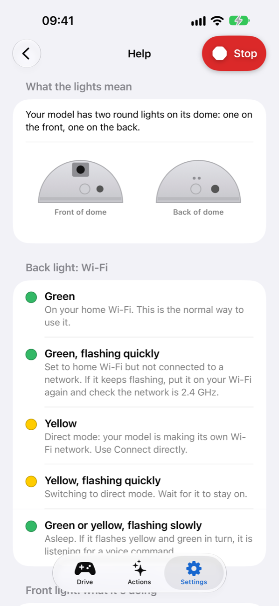

# Using Dome Pilot

Once your model is connected (see [getting started](getting-started)), the app has three
tabs: **Drive**, **Actions** and **Settings**. The red **Stop** button
 is always at the top right.

##  Drive

- The joystick drives; the two round arrows turn the dome. Hold an arrow to keep turning.
- The buttons above the joystick are shortcuts: play a sound, shake the head, the prop arm
  and the front light.
- Tap the **speed** chip to set a top speed, or to turn on **gentle mode**: slower, and
  the app asks before anything that makes your model move by itself.
- Start in a clear space. The model's obstacle sensors are off while you drive it.

###  Photos and videos

The camera picture fills the top of the Drive screen. Use the camera button for a photo
and the round button to record a video. Both are saved to your Photos library; the first
time, your device asks whether Dome Pilot may add to it.

Only one phone or tablet can show the camera at a time.

##  Actions

  
  
  

**Actions** has three sections.

- **Actions:** the model's built-in moves, lights, displays and routines. The app asks
  before any that make your model travel, so clear the floor first.
- **Sounds:** every built-in sound. Tap the star to make a favourite. If nothing plays,
  check your model isn't muted (Settings).
- **Sequences:** your own routines, made of actions, sounds and pauses, one after
  another.
  - **New sequence** to build one. **Start with one of these** offers a few ready-made
    ones to add and change.
  - **Share as a file** sends a sequence to someone else; **Open a file** brings one in.
    Sequences also work with [Siri and Shortcuts](siri-and-shortcuts).

##  Settings

  
  

- **Your model:** its name (connect to it first to change the name), battery,
  connection and software version.
- **Sound and senses:** **Mute** (no sounds at all), **Face detection** (it notices
  when someone is in front of it) and **Voice recognition** (it reacts when you talk to
  it).
- **Devices that can control this model:** the phones and tablets paired with it. You
  can remove one; it then can't control your model until it's paired again.
- **Turn off your model:** switches it off completely. You'll need to switch it on again
  by hand.
- **Switch model:** goes back to your list of models. Dome Pilot remembers several. In
  that list you can also **forget** one.
- **Driving:** top speed, gentle mode, and whether to show the camera while driving.
- **Game controller:** choose what each button does. See
  [getting started](getting-started).
- **Buzz when you tap:** a small vibration when you press things.
- **Help:** what the lights and buttons mean, what to try if it won't connect, and
  **Share diagnostics** for problem reports.

## The demo model

Tap **Try the demo** on the first screen to explore the app without your model. Everything
works except that nothing real moves. Settings shows "You're using the demo model".
